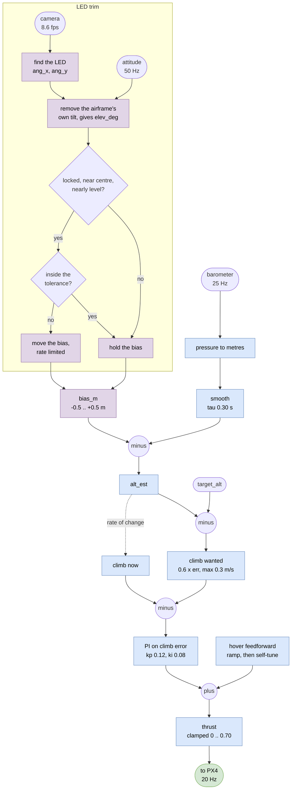
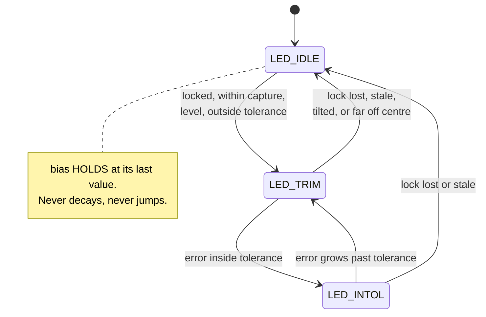

# Baro altitude hold, trimmed by the LED

What `main/baro_led_altitude.py` does. The barometer flies the aircraft; the
pink LED only corrects the barometer's drift.

- **below** — Mermaid. GitHub renders it inline; draw.io imports it via
  *Arrange → Insert → Advanced → Mermaid*.

## The idea

The LED never commands thrust. It moves one number — a **bias** on the altitude
estimate — slowly, and never by more than half a metre. Everything downstream of
that number is the unmodified baro cascade from `baro_takeoff_test.py`.

```
alt_est = baro_alt - bias_m          the only thing the LED touches
err_m   = target_alt - alt_est       unchanged from here down
```

The LED is mounted at the height we want to hold and the camera looks forward,
so an LED sitting level in the frame *is* the correct height. Nothing has to
know how far away it is.

## Signal flow



Blue is the existing baro cascade, purple is everything the LED adds.

## The trim's three states



`LED_IDLE` is the important one: losing the LED does not hand the aircraft a
step change, it simply stops improving the baro.

## The equations

| what | how |
|---|---|
| pressure to height | `h = 44330 (1 - (p / p_ref) ^ (1/5.255))` |
| tilt removed from the bearing | `elev = (ang_y cos φ - ang_x sin φ) - θ` |
| bias movement | `rate = clamp(-K elev, ±0.05 m/s)` |
| bias | `bias += rate · dt`, clamped to `±0.50 m` |
| corrected altitude | `alt_est = alt_baro - bias` |
| climb demanded | `climb_sp = clamp(0.6 · err, ±0.3 m/s)` |
| thrust | `hover_ff + PI(climb_sp - climb)`, clamped `0 .. 0.70` |

`φ` is roll and `θ` is pitch, both straight from the FC's attitude stream.
`elev` is positive when the aircraft is **above** the LED.

## Three things worth knowing

**The camera measures attitude as much as height.** It is bolted to the
airframe, so pitching the nose up moves the LED down the frame exactly as if
the aircraft had climbed. That is why the tilt is subtracted before the bearing
is used at all — without it the loop feeds its own attitude back to itself and
oscillates.

**The trim is deliberately slow.** Full scale is 0.05 m/s, so using the whole
half metre of authority takes ten seconds. Slow is what makes the rest of it
safe: the camera's answer is about 150 ms old, the attitude used to correct it
is a frame off, and the LED is only seen two thirds of the time. A slow
integrator averages all of that away. A fast one would chase it.

**It cannot run away.** The bias is hard-clamped to ±0.5 m, and the watchdog
that force-disarms on an altitude overshoot deliberately watches the **raw,
untrimmed** barometer against a 1.5 m limit. So even a completely wrong LED —
a false lock on a ceiling light, or a sign error — still leaves a metre of
margin before anything the vision system did could trip the limit.

## Running it

```sh
# from Horus-drones/main, on the Pi
python3 baro_led_altitude.py --alt 2.5                   # with the trim
python3 baro_led_altitude.py --alt 2.5 --no-led          # the baro baseline
```

`--no-led` is the same cascade with the bias pinned at zero, so it reproduces
`baro_takeoff_test.py`. Fly both back to back to see whether the trim helped:
`flight.csv` holds the altitude and thrust, `led_trim.csv` holds the bearing,
the tilt, the elevation and the bias, one row per camera frame.
