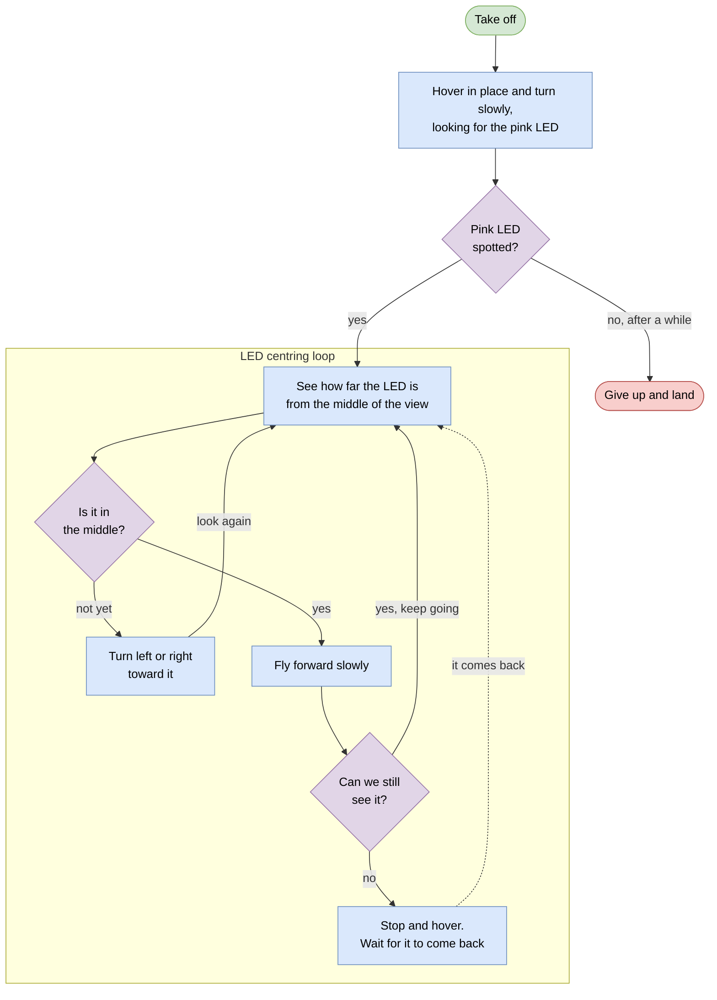

# How the drone follows the pink LED

High-level only — what the drone does, not how the code does it.

- **`led-tracking-loops.drawio`** — open in [diagrams.net](https://app.diagrams.net)
  or the VS Code Draw.io Integration extension. Editable.
- **below** — the same thing as Mermaid. draw.io imports it via
  *Arrange → Insert → Advanced → Mermaid*; GitHub renders it inline.

Three things worth knowing:

**Height never changes.** It is set at take-off and held for the whole flight.
Only turning and flying forward are controlled — the drone never climbs or
descends to follow the LED, even if the LED is well above or below it.

**The camera only tells us which way the LED is, never how far.** Nothing here
knows when it has arrived, so nothing stops it short of the target.

**Staying level and steady is not on this page.** The flight controller handles
that on its own, continuously, whatever the LED behaviour is doing.
